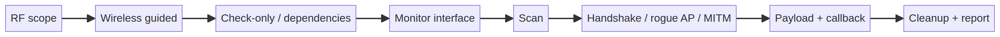

# Wireless Scanner & Payload Injector

Herramienta Python para organizar flujos de **evaluación inalámbrica autorizada** en Linux, desde el diagnóstico de dependencias hasta la operación de laboratorio y la limpieza. El proyecto conserva sus funciones operativas existentes; puede escanear, capturar handshakes, levantar un rogue AP, modificar forwarding/NAT, interceptar tráfico mediante MITM y generar payloads/callbacks. **No es una herramienta segura por defecto ni debe utilizarse contra redes, dispositivos o cuentas de terceros.**



> **Estado:** experimental · **Versión:** 2.1.0 · **Licencia:** MIT · **Python:** 3.10+

## Captura de interfaz

La siguiente captura procede de una ejecución real del CLI en un display virtual y muestra únicamente `--guided`. No se activó la radio, no se transmitieron frames y no se utilizaron datos de producción.


## Antes de usarlo

Las capacidades de deauth, captura de handshakes, cracking, rogue AP, DNS spoofing, MITM, inyección JavaScript y callbacks requieren autorización escrita específica. La autorización para escanear no incluye las demás técnicas. Trabaja con clientes, SSID, BSSID, credenciales y datos sintéticos de laboratorio; no guardes capturas, cookies, tokens, logs ni material de autenticación en Git.

Consulta la [política de seguridad](SECURITY.md) y la [guía de autorización](docs/authorization.md). El repositorio es material técnico para evaluación controlada, no una recomendación para producción.

## Características verificadas

| Área | Función |
|---|---|
| Diagnóstico | `--check-only` y salida JSON sin crear directorios ni activar radio |
| Wireless | Integración con `airmon-ng`, `airodump-ng`, `aireplay-ng` y `aircrack-ng` |
| Laboratorio | Configuración de hostapd, dnsmasq, forwarding y reglas de NAT |
| Intercepción | Integración con mitmproxy para respuestas HTTP en un entorno controlado |
| Payloads | Plantillas y generación de JavaScript/callbacks; revisar siempre el contenido |
| Operación | Menú interactivo, registro de alcance y rollback de procesos/reglas |

## Instalación

Requiere Bash y Python 3.10 o superior. El instalador usa el site de paquetes del usuario actual, no crea ni activa `.venv` y normalmente instala el entrypoint en `$HOME/.local/bin`.

```bash
./install.sh --help
./install.sh
export PATH="$HOME/.local/bin:$PATH"
wireless-injector --help
```

Las dependencias de sistema (`aircrack-ng`, `hostapd`, `dnsmasq`, `mitmproxy` e `iptables`) deben prepararse en una máquina de laboratorio conforme a la distribución utilizada. El instalador del proyecto no inicia operaciones inalámbricas.

## Diagnóstico sin radio

```bash
wireless-injector --check-only --json --interface wlan0 --uplink eth0
```

Este modo no requiere root, no activa la interfaz, no transmite frames y no crea los directorios operativos. También puedes mostrar el flujo recomendado sin ejecutar acciones:

```bash
wireless-injector --guided
```

## Pruebas

```bash
PYTHONPATH=src python3 -m unittest discover -s tests -v
python3 -m py_compile src/wireless_injector.py src/wireless_tool/*.py
git diff --check
```

## Flujo autorizado

El flujo esperado es `scope -> validate -> diagnose -> scan/capture -> payload/callback -> cleanup`. Antes de cualquier operación registra target, ventana, privilegios, dependencias, clientes de prueba, puertos y procedimiento de restauración. El modo diagnóstico, un plan o una captura no equivalen a una vulnerabilidad confirmada.

La [guía de tutorial](docs/tutorial.md) contiene un recorrido reproducible y seguro. Para el alcance mínimo de cada técnica, consulta [authorization.md](docs/authorization.md), [operator-checklist.md](docs/operator-checklist.md) y [cleanup.md](docs/cleanup.md).

## Privacidad y seguridad

La herramienta puede observar tráfico de clientes, escribir archivos de captura y registrar callbacks. Usa un entorno aislado, minimiza la retención y elimina los datos al terminar. Las plantillas de payload incluyen funciones de alto riesgo como keylogging, extracción de cookies, phishing, hooks y cryptomining; no las uses fuera de un laboratorio expresamente autorizado. Consulta [SECURITY.md](SECURITY.md) para el reporte responsable y los datos que no deben publicarse.

## Estructura

`src/wireless_tool/` separa CLI y engine; `check_environment` permite diagnóstico sin directorios ni radio; `archive/original/` mantiene trazabilidad; `tests/` verifica validaciones y cleanup; `docs/` contiene autorización, tutorial, seguridad operacional y materiales de promoción.

## Promoción y redistribución

El material de anuncio está en [docs/announcement.md](docs/announcement.md), la guía para terceros en [docs/third-party-promotion.md](docs/third-party-promotion.md) y el feed Atom en [docs/rss.xml](docs/rss.xml). Mantén la licencia MIT, el enlace canónico y las advertencias de uso autorizado. Respeta las normas de cada comunidad y no realices publicaciones masivas o no solicitadas.

## Historial

Consulta [CHANGELOG.md](CHANGELOG.md) para los cambios documentados de la versión 2.1.0.
