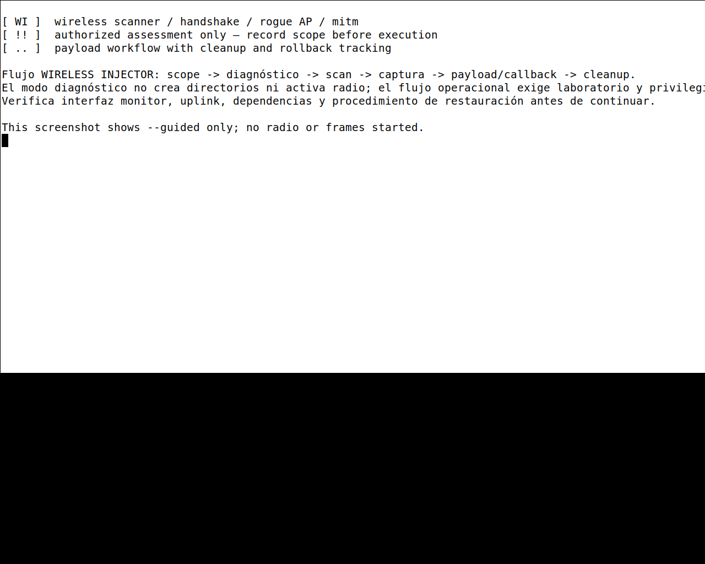

# Wireless Scanner & Payload Injector

<p align="center">
  
</p>

[](https://www.python.org/)
[](https://github.com/hubgunter4-ops/wireless-scanner-payload-injector/blob/main/LICENSE)
[](https://github.com/hubgunter4-ops/wireless-scanner-payload-injector)
[](https://github.com/hubgunter4-ops/wireless-scanner-payload-injector/commits/main)
[](https://github.com/hubgunter4-ops/wireless-scanner-payload-injector)
[](https://github.com/hubgunter4-ops/wireless-scanner-payload-injector)

Herramienta Python para organizar flujos de **evaluación inalámbrica autorizada** en Linux, desde el diagnóstico de dependencias hasta la operación de laboratorio y la limpieza. El proyecto conserva sus funciones operativas existentes; puede escanear, capturar handshakes, levantar un rogue AP, modificar forwarding/NAT, interceptar tráfico mediante MITM y generar payloads/callbacks. **No es una herramienta segura por defecto ni debe utilizarse contra redes, dispositivos o cuentas de terceros.**

> **Efectos operativos:** según el modo y la acción elegida, la herramienta puede invocar ejecutables externos, requerir privilegios, activar/desactivar interfaces de radio, iniciar procesos y servicios, crear o modificar archivos y cambiar forwarding, NAT o reglas de firewall. Ejecuta estas funciones únicamente en un laboratorio propio con autorización y un plan de reversión. `--dashboard` es una excepción de solo lectura: consulta disponibilidad local y no invoca esos ejecutores.


> **Estado:** experimental · **Versión:** 2.1.0 · **Licencia:** MIT · **Python:** 3.10+

## Captura de interfaz

La siguiente captura procede de una ejecución real del CLI en un display virtual y muestra únicamente `--guided`. No se activó la radio, no se transmitieron frames y no se utilizaron datos de producción.



## Antes de usarlo

Las capacidades de deauth, captura de handshakes, cracking, rogue AP, DNS spoofing, MITM, inyección JavaScript y callbacks requieren autorización escrita específica. La autorización para escanear no incluye las demás técnicas. Trabaja con clientes, SSID, BSSID, credenciales y datos sintéticos de laboratorio; no guardes capturas, cookies, tokens, logs ni material de autenticación en Git.

Consulta la [política de seguridad](SECURITY.md) y la [guía de autorización](docs/authorization.md). El repositorio es material técnico para evaluación controlada, no una recomendación para producción.

## Características verificadas

| Área | Función |
|---|---|
| Diagnóstico | `--check-only` y salida JSON sin crear directorios ni activar radio |
| Wireless | Integración con `airmon-ng`, `airodump-ng`, `aireplay-ng` y `aircrack-ng` |
| Laboratorio | Configuración de hostapd, dnsmasq, forwarding y reglas de NAT |
| Intercepción | Integración con mitmproxy para respuestas HTTP en un entorno controlado |
| Payloads | Plantillas y generación de JavaScript/callbacks; revisar siempre el contenido |
| Operación | Menú interactivo, registro de alcance y rollback de procesos/reglas |
| IoT | 6 perfiles de diagnóstico basados en la guía pública `uqbarun/uqbarun.github.io@4f09668` (web-api, firmware, wifi, ble, zigbee, sdr); solo chequeo de dependencias, sin ejecutar el perfil |

## Instalación

Requiere Bash y Python 3.10 o superior. El instalador usa el site de paquetes del usuario actual, no crea ni activa `.venv` y normalmente instala el entrypoint en `$HOME/.local/bin`.

```bash
./install.sh --help
./install.sh
export PATH="$HOME/.local/bin:$PATH"
wireless-injector --help
```

El instalador Python (`install.sh`) no instala las herramientas del sistema. En Ubuntu y Kali Linux, el CLI incluye el flujo apt para comprobar y, si se solicita explícitamente, instalar las dependencias faltantes. El instalador de paquetes puede ejecutar `apt-get update` e `apt-get install` con `sudo` y **modifica el sistema**; revisa primero la vista previa y úsalo en una máquina de laboratorio.

1. Comprueba el entorno y revisa los paquetes/comandos que se proponen:

```bash
wireless-injector --check-only
wireless-injector --check-only --dry-run
```

2. Solo si apruebas el cambio en Ubuntu o Kali basados en apt, invoca explícitamente el instalador integrado:

```bash
wireless-injector --check-only --install-missing
```

La relación binario→paquete deduplica `airmon-ng`, `airodump-ng`, `aireplay-ng` y `aircrack-ng` bajo `aircrack-ng`. Tras instalar, valida las rutas con `command -v airmon-ng airodump-ng aireplay-ng aircrack-ng hostapd dnsmasq mitmproxy iptables` y `wireless-injector --check-only --json`. Esto instala dependencias; no inicia una operación inalámbrica. Los nombres pueden variar por versión/distribución: revisa el `--dry-run` y consulta el gestor de paquetes local. No lo ejecutes en sistemas de producción.

## Diagnóstico sin radio

```bash
wireless-injector --check-only --json --interface wlan0 --uplink eth0
```

Este modo no requiere root, no activa la interfaz, no transmite frames y no crea los directorios operativos. También puedes mostrar el flujo recomendado sin ejecutar acciones:

```bash
wireless-injector --guided
```

Para ver el dashboard tabulado —con el tema negro, acentos rojos y tipografía magenta neón—, el estado de ejecutores/perfiles y un monitor local reproducible, sin activar radio:

```bash
wireless-injector --dashboard
```

El dashboard ofrece las pestañas Resumen, Ejecutores, Perfiles y Monitor. Pulsa `r` dentro de Monitor para repetir la comprobación de presencia en `PATH` y revisar sus resultados ahí mismo. La animación de carga y el símbolo diamante/Wi‑Fi se muestran en terminales compatibles. El monitor no inicia herramientas, no crea directorios, no instala paquetes y no activa radio. Consulta los [mockups y detalles de navegación](docs/cli-dashboard.md).

### Perfiles IoT

Basados en la guía pública de IoT pentest de
[uqbarun/uqbarun.github.io@4f09668](https://github.com/uqbarun/uqbarun.github.io/commit/4f096689b0ac4527682f66c36a8d29ca87ff647d)
(`_wiki/iot-pentest.md`, 2023-06-01). Son 6 perfiles de diagnóstico
— `web-api`, `firmware`, `wifi`, `ble`, `zigbee` y `sdr` — que solo
comprueban qué herramientas faltan para ese perfil, con sus
CWE/CAPEC de la guía. No ejecutan el perfil ni activan radio.
Zigbee no tiene binario apt estándar y se marca como hardware
dedicado, sin inventar paquete. Detalle en
[docs/iot-pentest.md](docs/iot-pentest.md).

```bash
wireless-injector --list-iot-profiles
wireless-injector --check-only --json --iot-profile ble
wireless-injector --check-only --iot-profile sdr --dry-run
```

## Pruebas

```bash
PYTHONPATH=src python3 -m unittest discover -s tests -v
python3 -m py_compile src/wireless_injector.py src/wireless_tool/*.py
git diff --check
```

## Flujo autorizado

El flujo esperado es `scope -> validate -> diagnose -> scan/capture -> payload/callback -> cleanup`. Antes de cualquier operación registra target, ventana, privilegios, dependencias, clientes de prueba, puertos y procedimiento de restauración. El modo diagnóstico, un plan o una captura no equivalen a una vulnerabilidad confirmada.

La [guía de tutorial](docs/tutorial.md) contiene un recorrido reproducible y seguro. Para el alcance mínimo de cada técnica, consulta [authorization.md](docs/authorization.md), [operator-checklist.md](docs/operator-checklist.md) y [cleanup.md](docs/cleanup.md).

## Privacidad y seguridad

La herramienta puede observar tráfico de clientes, escribir archivos de captura y registrar callbacks. Usa un entorno aislado, minimiza la retención y elimina los datos al terminar. Las plantillas de payload incluyen funciones de alto riesgo como keylogging, extracción de cookies, phishing, hooks y cryptomining; no las uses fuera de un laboratorio expresamente autorizado. Consulta [SECURITY.md](SECURITY.md) para el reporte responsable y los datos que no deben publicarse.

## Estructura

`src/wireless_tool/` separa CLI y engine; `check_environment` permite diagnóstico sin directorios ni radio; `archive/original/` mantiene trazabilidad; `tests/` verifica validaciones y cleanup; `docs/` contiene autorización, tutorial, seguridad operacional y materiales de promoción.

## Promoción y redistribución

El material de anuncio está en [docs/announcement.md](docs/announcement.md), la guía para terceros en [docs/third-party-promotion.md](docs/third-party-promotion.md) y el feed Atom en [docs/rss.xml](docs/rss.xml). Mantén la licencia MIT, el enlace canónico y las advertencias de uso autorizado. Respeta las normas de cada comunidad y no realices publicaciones masivas o no solicitadas.

## Historial

Consulta [CHANGELOG.md](CHANGELOG.md) para los cambios documentados de la versión 2.1.0.
