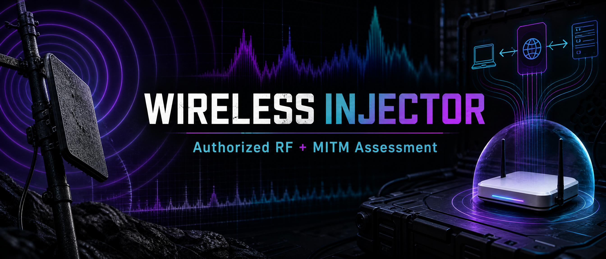

# WIRELESS INJECTOR — Wireless Assessment & Payload Workflow




WIRELESS INJECTOR conserva el propósito ofensivo del script recibido: escaneo Wi-Fi con `airodump-ng`, captura de handshakes WPA/WPA2, deauth autorizada, rogue AP con `hostapd`/`dnsmasq`, DNS spoofing, MITM mediante mitmproxy, generación de payloads JavaScript y recepción de callbacks.

> **No es un simulador.** Las rutas operativas mantienen efectos reales sobre radio, clientes, servicios y firewall. La reconstrucción añade robustez y controles, pero no elimina deauth, rogue AP, MITM, captura, cracking ni payloads. Ejecuta únicamente en una red y una ventana cubiertas por autorización escrita.

## Arquitectura de implementación

```text
src/wireless_injector.py
    └── wireless_tool.cli
          ├── engine.py  # escaneo, captura, rogue AP, MITM, payloads y cleanup
          └── __init__.py

archive/original/wireless_injector.py.original
```

`src/wireless_injector.py` es un entrypoint compatible. `wireless_tool.cli` separa diagnóstico de operación; `--check-only` no crea directorios, no requiere root y no activa radio. El engine conserva el menú y las acciones reales del script original.

## Capacidades

| Área | Implementación |
|---|---|
| Descubrimiento | `airodump-ng`, CSV de redes, duración e interfaz validadas. |
| Handshake | Captura dirigida, deauth autorizada y posterior cracking con wordlist. |
| Rogue AP | Configuración `hostapd`/`dnsmasq`, forwarding y NAT. |
| MITM | Script mitmproxy, redirección PREROUTING y rollback de reglas. |
| Payloads | Plantillas JavaScript, entrada personalizada, callback validado y servidor HTTP. |
| Cleanup | Terminación de procesos, timeout/kill, rollback de reglas y restauración managed. |
| Operación | Banner con tres variantes, diagnóstico JSON y variables de entorno. |

## Requisitos

La operación real requiere Linux, Python 3.10 o superior, root, un adaptador Wi-Fi compatible con modo monitor y una estación de laboratorio aislada. Deben estar disponibles `airmon-ng`, `airodump-ng`, `aireplay-ng`, `aircrack-ng`, `hostapd`, `dnsmasq`, `mitmproxy`, `iptables`, `ifconfig`/`net-tools` e `iwconfig`.

Este entorno de validación no proporciona una interfaz wireless de laboratorio ni objetivos autorizados. Por ello se comprueban código, validadores, cleanup, banners y diagnóstico; no se afirma una captura de handshake, rogue AP, MITM o transmisión de frames.

## Instalación

```bash
git clone https://github.com/hubgunter4-ops/wireless-scanner-payload-injector.git
cd wireless-scanner-payload-injector
python3 -m venv .venv
. .venv/bin/activate
python -m pip install --upgrade pip
python -m pip install -e .
```

Dependencias del sistema en una estación desechable o snapshot:

```bash
sudo apt update
sudo apt install -y aircrack-ng hostapd dnsmasq iptables net-tools wireless-tools
python -m pip install mitmproxy
```

No conectes el adaptador ni inicies servicios de captura durante la instalación. Configura las rutas de trabajo explícitamente:

```bash
export WIRELESS_INTERFACE=wlan0
export UPLINK_INTERFACE=eth0
export WIRELESS_OUTPUT_DIR="$PWD/wireless_captures"
export ROGUE_AP_DIR="$PWD/rogue_ap"
export PAYLOADS_DIR="$PWD/payloads_web"
```

## Diagnóstico sin radio

Muestra una variante del banner:

```bash
wireless-injector --show-banner --banner-style 1
```

Comprueba configuración y herramientas sin crear carpetas ni iniciar procesos wireless:

```bash
wireless-injector --check-only --json \
  --interface wlan0 \
  --uplink eth0
```

La salida JSON diferencia `missing_tools`, interfaz monitor prevista, uplink, `radio_started: false` y la nota de diagnóstico.

## Operación ofensiva autorizada

La entrada interactiva conserva las acciones del tool original:

```bash
sudo -E wireless-injector --interface wlan0 --uplink eth0 --banner-style 0
```

Las acciones incluyen escaneo, captura de handshake, cracking, configuración/inicio de rogue AP, creación de payload JavaScript, creación/inicio de mitmproxy, servidor de callbacks y flujo completo. Antes de cada acción registra BSSID, canal, ESSID, clientes, interfaz, uplink, puertos, regla de firewall y condición de parada.

El repositorio no convierte la operación real en un mock. Para generar evidencia de la operación completa, utiliza una red RF aislada con clientes sintéticos y conserva únicamente capturas anonimizadas según la política del engagement.

## Sanitización y robustez

Las interfaces aceptan únicamente nombres de hasta 15 caracteres con letras, números, punto, guion o guion bajo. Las MAC/BSSID exigen seis octetos hexadecimales; los canales se limitan a 1–196; los puertos, a 1–65535; los SSID, a 32 caracteres sin saltos de línea; y los callbacks, a IP o hostname sintácticamente acotado.

Los comandos externos se ejecutan como listas de argumentos, sin `shell=True`. Las rutas de salida se configuran mediante variables o CLI y se registran las reglas de eliminación en orden inverso. El cleanup intenta terminar procesos, usa `kill` cuando el timeout expira y limpia la tabla de reglas registrada por la instancia.

La robustez del proceso no garantiza rollback frente a un apagado abrupto, cambios realizados por operadores externos o reglas que no pertenecen a esta instancia. Toma snapshot de `iptables`, registra el estado de NetworkManager y valida la interfaz managed al finalizar.

## TTPs y perspectiva purple team

| TTP | Acción | Telemetría defensiva |
|---|---|---|
| Network Service Scanning | `airodump-ng` y enumeración de redes | WIDS/WIPS, aparición de modo monitor y eventos del AP. |
| Adversary-in-the-Middle | Rogue AP, DNS spoofing y proxy transparente | SSID duplicado, ARP/DNS anómalo, certificados y proxy. |
| Network Denial of Service | Deauth durante captura | Frames deauth, pérdida de clientes y cambios de canal. |
| Input/Content Injection | Inyección JS en respuestas HTTP | WAF, CSP, proxy, integridad de contenido y logs de navegador. |
| Credential Access | Cracking de capturas autorizadas | Custodia de `.cap`, procesos aircrack y acceso a wordlists. |

## Pruebas comprobables

```bash
python3 -m py_compile src/wireless_injector.py src/wireless_tool/*.py
PYTHONPATH=src python3 -m unittest discover -s tests -v
wireless-injector --show-banner --banner-style 1
wireless-injector --check-only --json --interface wlan0 --uplink eth0
```

La suite cubre validación de entradas, banners, construcción side-effect-free, cleanup/rollback con procesos falsos y diagnóstico JSON. No llama a `airmon-ng`, `airodump-ng`, `aireplay-ng`, `hostapd`, `dnsmasq`, mitmproxy ni `iptables` reales durante la validación.

## Estructura

```text
.
├── archive/original/wireless_injector.py.original
├── assets/
├── docs/
│   ├── authorization.md
│   ├── cleanup.md
│   └── operator-checklist.md
├── evidence/
├── pyproject.toml
├── src/
│   ├── wireless_injector.py
│   └── wireless_tool/
│       ├── __init__.py
│       ├── cli.py
│       └── engine.py
├── tests/test_wireless.py
└── tools/render_evidence.py
```

## Referencias

[1]: https://www.aircrack-ng.org/ "Aircrack-ng official documentation"
[2]: https://www.mitmproxy.org/ "mitmproxy official documentation"
[3]: https://hostap.epitest.fi/hostapd/ "hostapd project documentation"
[4]: https://attack.mitre.org/techniques/T1557/ "MITRE ATT&CK — Adversary-in-the-Middle"
[5]: https://attack.mitre.org/techniques/T1498/ "MITRE ATT&CK — Network Denial of Service"
