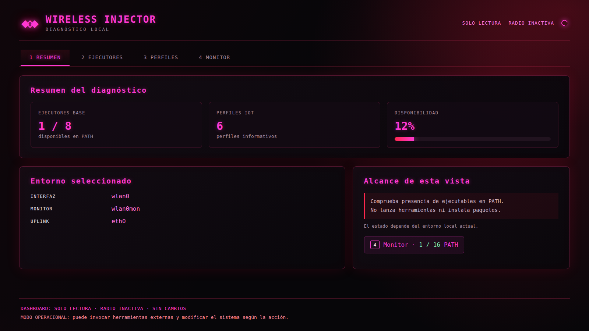
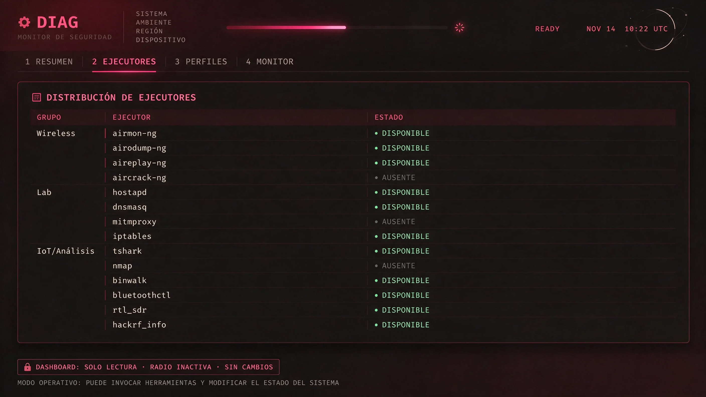
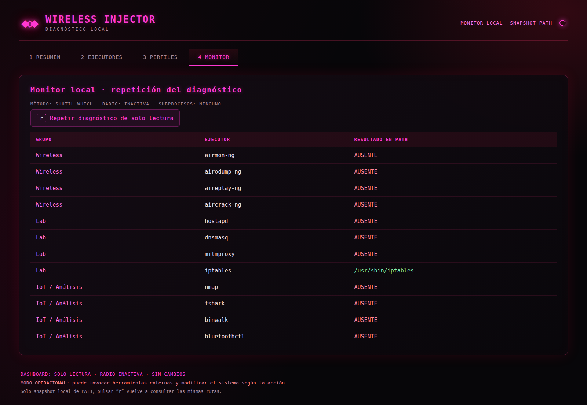

# Dashboard de diagnóstico para la CLI

El modo `--dashboard` ofrece cuatro pestañas: **Resumen**, **Ejecutores**, **Perfiles** y **Monitor**. En una TTY se navega con `1`–`4`, `q` sale y `r` vuelve a ejecutar el chequeo local desde Monitor. Sin TTY imprime las cuatro vistas en secuencia. El tema usa fondo negro, separadores rojos, acentos magenta neón y una animación breve de carga, desactivable con `--no-animation`.

El README muestra el GIF del diamante Wi‑Fi. Dentro de la CLI, el terminal presenta un monograma diamante/ondas con los acentos de marca y el indicador animado; las terminales no tienen soporte universal para imágenes GIF inline.

```bash
wireless-injector --dashboard
wireless-injector --dashboard --interface wlan0 --uplink eth0
wireless-injector --dashboard --no-animation
```

## Monitor integrado y reproducibilidad

El **Resumen** incluye un mini monitor con el conteo compacto de los mismos 16 ejecutores que aparecen en la pestaña **Monitor** y un acceso a esa vista detallada. Monitor presenta, en la misma interfaz, un snapshot ordenado de la presencia de cada ejecutable en `PATH`. Al pulsar `r`, repite el mismo chequeo local y reemplaza la vista por los resultados actuales. El método utilizado es `shutil.which`; no se lanzan los ejecutables, no se crean directorios y no se accede a interfaces de radio. El resultado depende del `PATH` y del entorno local.

> **Alcance:** el dashboard es de solo lectura. El modo operacional del proyecto es distinto y, dependiendo de la acción seleccionada, puede invocar herramientas externas y modificar el sistema —por ejemplo interfaces de radio, procesos, archivos, forwarding, NAT o reglas de firewall—. Requiere autorización, laboratorio y plan de reversión.

## Conceptos visuales

Las imágenes son mockups de diseño, no capturas funcionales ni datos reales.

### 1. Resumen negro, rojo y magenta neón



### 2. Distribución compacta de ejecutores



### 3. Monitor local repetible



## Distribución

- **Resumen:** interfaces seleccionadas, disponibilidad general, barra de avance y mini monitor PATH con acceso a Monitor.
- **Ejecutores:** herramientas agrupadas en Wireless, Lab e IoT/Análisis con estado presente/ausente.
- **Perfiles:** los seis perfiles IoT y una señal clara cuando se requiere hardware dedicado.
- **Monitor:** rutas locales detectadas, estado de cada binario y refresco repetible con `r`.

El monitor solo observa disponibilidad. No ofrece botones para lanzar acciones operacionales.
